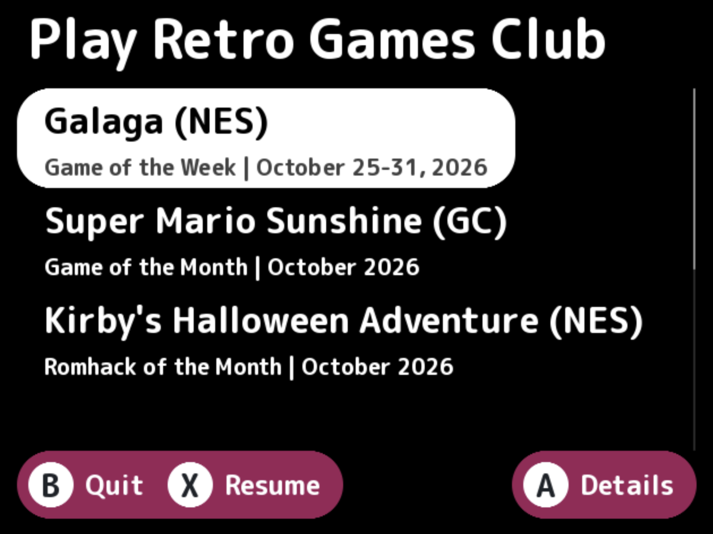
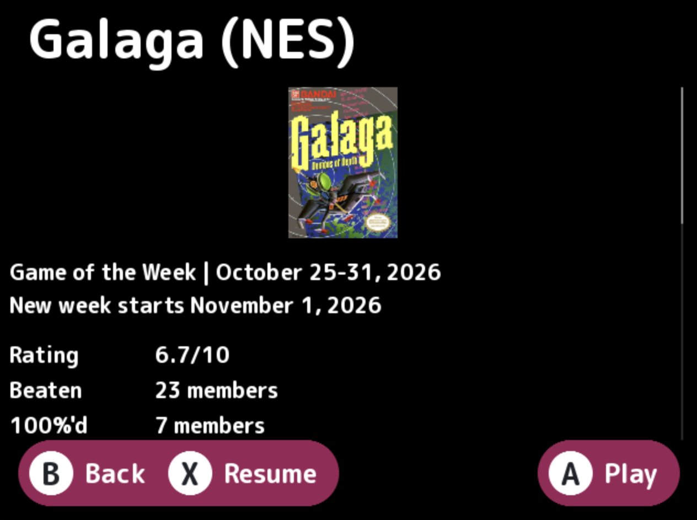

# Play Retro Games Club Tracker

Find and launch the club's current games, right from your handheld!

<p>
  
  
</p>

This NextUI Pak shows what the
[Play Retro Games Club](https://www.joeysretrohandhelds.com/play-retro-games-club/)
is playing right now: Game of the Week, Game of the Month, Romhack of the
Month, Game of the Season and any specials, with each game's stats and
description.

Since handhelds can't open links, each game's page has QR codes to scan with
your phone: one for the game on RetroAchievements, and one for the guide the
club lists for it.

Not affiliated with Joey’s Retro Handhelds, the Play Retro Games Club or RetroAchievements.

## What you need

- Wi-Fi, to load the club's current games. After the first load, the Pak
  keeps a copy, so you can still browse and play offline: it shows the games
  from the last time you were online, marked with how old they are. Playing a
  game also needs Wi-Fi once per console, the first time, to download
  RetroAchievements' list of known ROMs.
- Your own ROMs, of a version RetroAchievements recognizes (any file name
  works; it's the file's contents that count)
- An emulator for the game's console. NextUI plays most retro consoles out of
  the box; for Nintendo 64 and Dreamcast, the Pak tells you which emulator to
  get from the Pak Store. Games for consoles NextUI can't play (GameCube, Wii,
  PS2…) can still be browsed, but not launched.

## How does it find what game we're playing?

Every ROM file has a "hash", which is a unique identifier that emulators use to verify that the game file you're using is compatible with RetroAchievements. This Pak uses game hashes to find which game on your card matches the game the Club is playing.

The steps go as follows (we'll use Galaga (NES) as an example): 
- The Pak goes to the [Play Retro Game Club website](https://www.joeysretrohandhelds.com/play-retro-games-club/), and gets the link to the matching [RetroAchievements](https://retroachievements.org/game/1701) page
- The Pak then gets a [list of supported hashes](https://retroachievements.org/game/1701/hashes) (i.e. ROM files that will work)
- The Pak also gets a list of hashes from your ROM folder
- If no games match a supported hash, the Pak gives an error message
- If exactly one game matches a supported hash (and the emulator is installed), the Pak will launch the game
- If more than one game matches a supported hash (ex: you have two copies of "Galaga - Demons of Death (USA).nes", or you have both "Galaga - Demons of Death (USA).nes" and "Galaga (Europe).nes"), it does some tiebreakers
  - If some of them have save states, only those are considered
  - Of those, the one you played most recently (in "Recently Played") is launched
  - If none of them has been played, the Pak will ask which one you'd like to play

## Coding Stuff

For how the Pak works under the hood (the screens, how a ROM is matched and
launched, how the club page is read, and the tests), see the
[developer details](./DEV-DETAILS.md).

### Requirements

- [Meson](https://mesonbuild.com/) and Ninja
- [Task](https://taskfile.dev/)
- SDL2, SDL2_ttf, SDL2_image and libcurl, for native builds
- Docker, for device builds

On macOS: `brew install meson ninja go-task sdl2 sdl2_ttf sdl2_image`, plus
Docker Desktop for device builds.

```
task build     # native, for development
task run       # native, and launch it
```

The device build runs inside the NextUI toolchain container and produces a
single binary for every handheld: `tg5040` (TrimUI Brick / Smart Pro),
`tg5050` (Smart Pro S), `my355` (Miyoo Flip) and `h700` (Anbernic).

```
task device                    # cross-compile
task pak                       # assemble the Pak in dist/
task package                   # zip it into dist/PRGC.Tracker.pak.zip
task adb PLATFORM=tg5040       # build, assemble and push over adb
```

The first device build also compiles curl and OpenSSL, which takes a while.

## Installing by hand

Create `Tools/<platform>/PRGC Tracker.pak/` on the SD card and extract
`PRGC.Tracker.pak.zip` into it:

```
Tools/tg5040/PRGC Tracker.pak/
├── launch.sh
├── prgc-tracker
├── cacert.pem
├── LICENSE.txt
└── THIRD-PARTY-NOTICES.txt
```

The saved page and box art live in `$SHARED_USERDATA_PATH/prgc-tracker` on
device (`~/.userdata/prgc-tracker` elsewhere), along with RA's hash lists and
the ROM hash cache (`hashes-v2.tsv`); the log is
`$LOGS_PATH/prgc-tracker.txt`.

## AI Disclosure

This code was written with AI-assistance. For more info, see the [AI Disclosure](./AI-DISCLOSURE.md).

## Copyright Notice

This project *does not* provide game ROM files. Please use your own legally obtained ROMs.

## Licence

MIT; see `LICENSE.txt`. Bundled components (Apostrophe, rcheevos, qrcodegen,
curl, OpenSSL and a CA bundle) are under their own terms in `THIRD-PARTY-NOTICES.txt`. Game data
and box art are fetched at runtime from joeysretrohandhelds.com and
retroachievements.org and are not distributed with the Pak.
